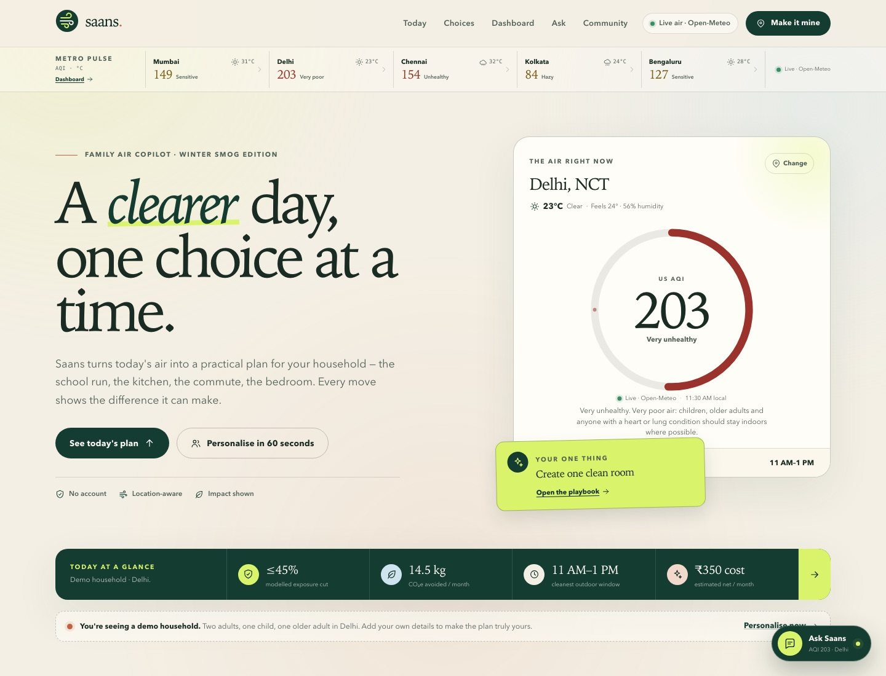
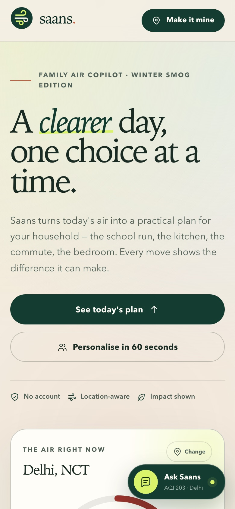
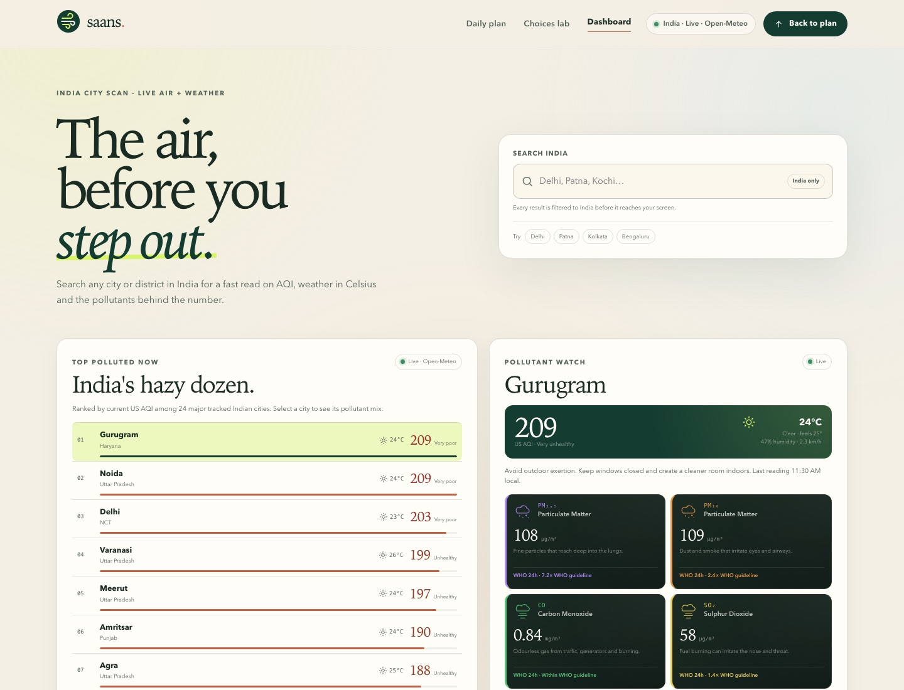

<h1 align="center">Saans</h1>

<p align="center">
  <strong>A family air copilot for severe winter smog and urban air pollution.</strong><br />
  <sub>Location-aware plans · indoor-air hacks · pollutant reports · grounded AI</sub>
</p>

<p align="center">
  <a href="https://github.com/amardeepio/Saans/actions/workflows/ci.yml"></a>
  
  
  
  
  
  
</p>

<p align="center"><sub>Saans means breath.</sub></p>

<p align="center">
  <a href="https://saans-api7jwjpza-uc.a.run.app"><strong>Open the live app →</strong></a>
  <br />
  <sub>Deployed on Google Cloud Run · us-central1</sub>
</p>

Saans turns a city’s live air quality into a practical, low-emission plan for a real household. It combines location, household vulnerability, home energy use, daily mobility and budget to answer three questions:

1. **What should we do today?**
2. **What will actually make a difference?**
3. **How do we keep the good habits going?**

The experience is a location-aware dashboard and a grounded AI chat assistant that opens from a floating button on the right. There is no login, no database and no server-side profile storage.

> Saans is not a medical device. It provides exposure-reduction guidance and modelled estimates, not diagnosis, treatment or guaranteed health outcomes.



<table>
  <tr>
    <td width="67%"></td>
    <td width="33%"></td>
  </tr>
  <tr>
    <td><sub>The context-aware chat drawer. The optional GenAI layer is grounded in the household plan and falls back safely.</sub></td>
    <td><sub>Responsive down to 390 px.</sub></td>
  </tr>
</table>

<table>
  <tr>
    <td width="58%"></td>
    <td width="42%"></td>
  </tr>
  <tr>
    <td><sub>Top polluted tracked cities, India-only search and a live pollutant watch.</sub></td>
    <td><sub>Click any metro card for a complete city air report.</sub></td>
  </tr>
</table>

---

## Quality at a glance

| Signal | Result |
| --- | --- |
| **Language** | TypeScript strict mode, zero type errors |
| **Tests** | 111 tests across 25 files |
| **Line coverage** | **92.56%** |
| **Statement coverage** | 88.36% |
| **Function coverage** | 92.73% |
| **Branch coverage** | 71.12% |
| **Accessibility** | 0 axe-core WCAG 2.1 A/AA violations on home, dashboard, setup, chat and mobile |
| **Build** | Passing Next.js production build |

Coverage is measured across the core TypeScript logic in `lib/` and enforced in CI with minimum thresholds. Run `npm run test:coverage` to reproduce it locally.

---

## Chosen vertical

**Climate & sustainable living → urban air quality and household resilience.**

The primary persona is a multi-generational household in the Indo-Gangetic plain during winter smog: children, older adults, someone with a respiratory condition, a two-wheeler or car commute, and a real budget. A secondary persona is the neighbourhood organiser who needs a simple way to turn household habits into shared rules.

---

## What the app does

- **Live location context** — city search, browser geolocation, live air quality and current weather in Celsius from the free Open-Meteo API.
- **Metro pulse** — a compact strip directly below the header with AQI and temperature for Mumbai, Delhi, Chennai, Kolkata and Bengaluru.
- **Clickable city reports** — open any metro card for AQI, weather in °C and six major pollutants: PM2.5, PM10, CO, SO2, NO2 and O3.
- **India dashboard** — `/dashboard` ranks 24 major tracked Indian cities by AQI, provides India-only location search and shows a selected city’s pollutant mix.
- **US AQI ↔ Indian NAQI** — a persistent scale toggle across the orb, plan, dashboard and chat. Indian NAQI is estimated with CPCB breakpoints, shows the dominant pollutant and its sub-indices, and flags Delhi-NCR GRAP context when NAQI crosses an official stage range.
- **24-hour air curve** — an accessible inline SVG with hourly AQI bars, cleanest and roughest windows, a wind line, stagnation shading and a screen-reader table.
- **Weather-aware guidance** — a dispersion score, inversion risk and best ventilation window derived from wind, humidity, temperature and rain.
- **Pollutant cards** — dark, colour-coded readings with WHO guideline comparisons, NAQI sub-indices and plain-language context.
- **Household-aware risk** — children, older adults, pregnancy, respiratory conditions and pets change the plan’s weight, not just the colour of a badge.
- **A daily playbook** — 6–9 time-ordered actions across the school run, commute, kitchen, cleaning, outdoor window, sleep and community.
- **A habit loop** — check off actions, watch a daily progress ring, build a streak and review the last seven days.
- **Direct impact for every choice** — estimated PM2.5 exposure reduction, CO₂e avoided per month, rupee savings/cost and effort level.
- **A choices lab** — toggle realistic swaps (one transit day, no indoor burning, filtering one room, pressure cooking) and see the modelled difference update live.
- **A grounded assistant** — a right-side, floating chat drawer with household context, suggested questions, optional voice input and read-aloud, and an optional Groq/GenAI backend. If the provider is missing or unsafe, it falls back to a deterministic local assistant.
- **A community kit** — a ready-to-send neighbour note, no-idling/no-burning prompts and a clean-air corner idea.
- **Installable and offline-ready** — a web manifest, service worker, offline page, last-known reading cache and install prompt.
- **Air alerts** — in-app threshold banners, browser notifications, quiet hours, and clean-window calendar export.
- **Hindi and simple mode** — a language switcher, Hindi UI copy, read-aloud and a low-clutter simple mode.
- **A real fallback** — if live data fails, the UI clearly says it is using a sample winter pattern. Nothing pretends to be live.

---

## Approach and logic

### 1. Context before content

Saans collects only what changes the advice:

| Context | Why it matters |
| --- | --- |
| City / coordinates | Outdoor AQI, weather in °C and the cleanest two-hour window |
| Adults, children, older adults | Vulnerability weighting |
| Respiratory condition, pregnancy | Higher protection threshold |
| Cooking fuel, indoor smoke, purifier | Controllable indoor sources |
| Primary mobility, commute minutes, school run | Exposure and carbon trade-offs |
| Budget and priorities | Feasibility and what gets ranked first |

Profiles are saved only in `localStorage`, are versioned, and are re-validated when loaded.

### 2. A deterministic decision engine

`lib/engine.ts` builds a candidate set of actions, then scores and prunes it. The score combines:

- **Exposure benefit** — largest weight.
- **Household vulnerability** — children, older adults, respiratory conditions, pregnancy.
- **Carbon benefit** — for commutes and cooking.
- **Money** — savings or recurring cost.
- **Feasibility** — budget, purifier ownership, mobility mode, indoor smoke source.
- **Time and effort** — actions are re-ordered into a morning → midday → evening → night routine.

The engine uses explicit thresholds rather than a black box. Health risk is derived from the PM2.5/US AQI reading:

- AQI ≤ 50: clear
- 51–100: moderate
- 101–150: unhealthy for sensitive groups
- 151–200: unhealthy
- 201–300: very unhealthy
- 301+: hazardous

Risk is raised further for vulnerable households. The UI always shows the category, source and observation time.

### 3. Indian NAQI, dominant pollutants and GRAP

The display can switch between **US AQI** and the **Indian National AQI (NAQI)**:

- NAQI is estimated from the current pollutant mix using CPCB breakpoints for PM2.5, PM10, CO, SO2, NO2 and O3.
- The highest sub-index sets the overall value and the dominant pollutant is shown alongside it.
- Because the official NAQI is built from 24-hour/8-hour averages and Saans usually has a current snapshot, NAQI is explicitly labelled **estimated**.
- Delhi-NCR cities show a **GRAP context** card when NAQI crosses 201. The wording is deliberately “conditions consistent with Stage X” — only CAQM can formally invoke a stage.
- The toggle changes the display scale; health weighting stays tied to PM2.5 concentration so risk does not jump when the scale changes.

### 4. Weather, dispersion and ventilation

Weather is not just decoration:

- `lib/dispersion.ts` scores how well the atmosphere is mixing using wind, humidity, temperature, rain and boundary-layer height.
- The plan uses that score to recommend when to air a room, when to keep windows sealed, and when an inversion is trapping pollution.
- The 24-hour curve shows the cleanest and roughest windows, plus a wind line and stagnation shading.

### 5. Impact estimates are deliberately capped

Exposure values are **directional estimates**, not measurements:

- Each action gets an estimated share of daily PM2.5 exposure reduced.
- The household total combines these with diminishing returns, then caps the result at **45%**.
- Carbon estimates use typical Indian fuel/electricity assumptions.
- Cost estimates are monthly and can be positive (savings) or negative (spend).
- Every relevant panel has a “How these estimates work” disclosure.

This avoids the common trap of adding ten optimistic percentages together and presenting the result as a health promise.

### 6. Hybrid GenAI, with a safety net

The assistant has two layers:

**Layer 1 — optional GenAI**
- Any OpenAI-compatible endpoint can be used. The included configuration targets **Groq** with `openai/gpt-oss-120b`.
- The key lives only in `.env.local` / server environment variables. It is never sent to the browser.
- The system prompt includes household context and explicit safety rules.
- The response is converted to plain text and checked by a narrow output guard. Advice to open windows during dirty air, put a child on a two-wheeler in heavy smog, or use ozone/DIY purifier solutions is rejected.
- If the provider is slow, down, rate-limited or emits unsafe advice, Saans silently falls back.

**Layer 2 — deterministic local assistant**
- Intent detection maps the question to school, purifier, commute, outdoor timing, cooking smoke, health, cost, community, plants or sleep.
- Answers use the same live reading and household profile as the plan.
- The app remains fully usable without any API key.

### 7. Habits, alerts, offline use and language

- **Habits** — completed actions are stored per local day, with a progress ring, streak and seven-day review. Nothing leaves the browser.
- **Alerts** — users can set a threshold, quiet hours and a school-run reminder. The app shows an in-app banner, can send a browser notification, and exports the clean window as an `.ics` calendar event.
- **Offline** — a service worker caches the app shell and last API responses; the most recent reading is also kept in `localStorage`. If the network or upstream data fails, the UI says so and falls back to the last saved reading or a labelled sample.
- **Language** — UI copy has a static Hindi dictionary. Generated plan and assistant text can be translated server-side with Google Translate when `GOOGLE_TRANSLATE_API_KEY` is configured; otherwise it stays in reviewed English. Read-aloud and voice input use the browser Web Speech API, so no audio leaves the device.
- **Simple mode** — reduces secondary detail and increases type size for low-bandwidth or low-literacy contexts.

### 8. Privacy and safety by default

- No account, cookies, analytics or database.
- Profile is stored in the browser.
- Chat history lives in component state and is not persisted.
- GenAI requests contain only the context needed for the answer; they are not logged by the app.
- Translation is opt-in by language choice. When enabled, generated plan/assistant copy is sent to Google Translate through a server route; the API key is never exposed to the browser. No household profile is sent for translation.
- The server does not expose secrets or provider error details.
- Medical red flags redirect to emergency care rather than attempting triage.

---

## How the solution works

```text
Browser
  ├─ 3-step household setup (local state + localStorage)
  ├─ daily playbook / habit loop / choices lab / community kit / pollutant reports
  ├─ US AQI ↔ Indian NAQI toggle + GRAP context
  ├─ 24-hour air curve + dispersion/ventilation panel
  ├─ /dashboard: India ranking + India-only search
  ├─ floating chat drawer with optional voice input and read-aloud
  ├─ PWA service worker + last-known reading cache
  ├─ settings: scale, language, simple mode, alerts, calendar export
  └─ POST /api/chat
        ├─ same-origin check + in-memory rate limit + 24 KB body cap
        ├─ validate + clamp profile and air data
        ├─ build deterministic advice on the selected AQI scale
        ├─ optional Groq request (server-only key, time-limited)
        │     └─ output guard → local fallback if unsafe/failed
        ├─ optional Hindi translation (server-only Google key)
        └─ JSON answer (no storage)

Server routes
  ├─ GET /api/air?lat&lon…     → Open-Meteo current + 24h forecast + hourly weather
  │                              → labelled sample fallback on failure
  ├─ GET /api/cities           → five metro summaries (AQI, °C, pollutants)
  ├─ GET /api/india-cities     → 24-city India ranking (batched, cached 15 min)
  ├─ GET /api/geocode?q=…      → curated cities + Open-Meteo geocoding
  │                              (`country=IN` filters server-side)
  └─ POST /api/translate       → optional server-side Hindi translation
```

### Project structure

```text
app/
  api/air/route.ts           Live air reading + hourly weather + sample fallback
  api/cities/route.ts        Five-metro AQI, weather and pollutant summaries
  api/india-cities/route.ts  24-city India ranking (one batched upstream call)
  api/chat/route.ts          Validated, rate-limited assistant endpoint
  api/geocode/route.ts       City search, optional India-only filter
  api/translate/route.ts     Optional server-side Hindi translation
  dashboard/page.tsx         India city dashboard
  dashboard/loading.tsx      Dashboard skeleton
  offline/page.tsx           Offline fallback page
  manifest.ts                PWA manifest
  template.tsx               Route enter transition
  globals.css                Design system, motion and responsive layout
  layout.tsx                 Metadata, viewport, provider and route progress
  page.tsx                   Server entry
  icon.svg                   App icon
public/
  sw.js                      Offline cache, push and notification handlers
  icons/                     PWA icons
components/
  SaansApp.tsx               Client dashboard composition
  AqiOrb.tsx                 AQI visual with source + active scale
  AqiScaleToggle.tsx         US AQI ↔ Indian NAQI control
  AirCurve.tsx               24-hour accessible SVG curve
  AtmosphereCard.tsx         Dispersion, inversion and ventilation panel
  GrapNotice.tsx             Delhi-NCR GRAP context card
  HabitProgress.tsx          Progress ring, streak, weekly review and done toggle
  SettingsDialog.tsx         Scale, language, simple mode and alert settings
  RouteProgress.tsx          Top navigation progress bar
  PwaManager.tsx             Service worker registration and install prompt
  PreferencesProvider.tsx    Persisted app preferences
  ListenButton.tsx           Read-aloud control
  CityPulse.tsx              Five-metro AQI and °C strip below the header
  CityDetailDialog.tsx       Accessible city AQI + weather + pollutant report
  DashboardApp.tsx           India ranking + India-only search
  PollutantGrid.tsx          Six-card pollutant watch with NAQI sub-indices
  WeatherGlyph.tsx           WMO weather-code icons
  Playbook.tsx               Timeline, risk, windows, habit and impact ledger
  ChoiceLab.tsx              Interactive swap simulator
  Assistant.tsx              Floating button + chat drawer + voice input
  SetupDialog.tsx            Accessible 3-step profile dialog
  SwapsSection.tsx           Sustainable swaps + community note
lib/
  aqi.ts                     US EPA AQI, categories and risk weighting
  naqi.ts                    CPCB NAQI, sub-indices and GRAP stages
  measurement.ts             Active AQI scale selector
  dispersion.ts              Dispersion score and ventilation window
  air.ts                     Open-Meteo fetch, hourly weather and fallback
  engine.ts                  Household decision engine
  assistant.ts               Intent-aware local assistant
  ai.ts                      Optional GenAI + output safety guard
  translate.ts               Server-only optional translation
  localize-advice.ts         Translate/merge the generated plan
  habits.ts                  Local habit history, streaks and weekly review
  alerts.ts                  Alert rules, dedupe and notifications
  calendar.ts                Clean-window .ics export
  settings.ts                Versioned preferences and alert defaults
  offline.ts                 Last-known reading cache
  i18n.ts                    Static English/Hindi UI dictionaries
  speech.ts                  Web Speech read-aloud and voice input
  sample-air.ts              Deterministic, clearly-labelled sample data
  weather.ts                 Celsius weather labels and sample fallback
  pollutants.ts              Pollutant metadata, units and WHO comparisons
  india.ts                   India-only filtering and tracked-city universe
  validation.ts              Input clamping and local-storage schema
  rate-limit.ts              Small in-memory limiter
tests/                       111 unit tests across 25 files
```

---

## Live deployment

Saans is deployed on **Google Cloud Run** using Cloud Buildpacks — there is no Dockerfile to maintain.

| Setting | Value |
| --- | --- |
| **Live URL** | https://saans-api7jwjpza-uc.a.run.app |
| **GCP project** | `gen-lang-client-0631726228` |
| **Service** | `saans` |
| **Region** | `us-central1` |
| **Runtime** | Cloud Run (managed), Node.js 22 buildpack |
| **Memory / CPU** | 1 GiB / 1 vCPU |
| **Instances** | 0 minimum, 3 maximum |
| **Access** | Public, unauthenticated |

### How it was deployed

1. **Authenticate and select the project**

   ```bash
   gcloud auth login
   gcloud config set project gen-lang-client-0631726228
   ```

2. **Enable the required APIs** (already enabled for this project)

   ```bash
   gcloud services enable \
     run.googleapis.com \
     cloudbuild.googleapis.com \
     artifactregistry.googleapis.com \
     secretmanager.googleapis.com
   ```

3. **Store secrets in Secret Manager**

   ```bash
   # Paste the value when prompted; never put keys in source control.
   gcloud secrets create saans-groq-api-key --data-file=-
   gcloud secrets create saans-google-translate-api-key --data-file=-
   ```

   Grant the Cloud Run runtime service account access:

   ```bash
   for secret in saans-groq-api-key saans-google-translate-api-key; do
     gcloud secrets add-iam-policy-binding "$secret" \
       --member="serviceAccount:301104363527-compute@developer.gserviceaccount.com" \
       --role="roles/secretmanager.secretAccessor"
   done
   ```

4. **Deploy from source**

   ```bash
   gcloud run deploy saans \
     --source . \
     --region us-central1 \
     --platform managed \
     --allow-unauthenticated \
     --port 3000 \
     --memory 1Gi \
     --cpu 1 \
     --min-instances 0 \
     --max-instances 3 \
     --timeout 60 \
     --set-env-vars AI_BASE_URL=https://api.groq.com/openai/v1,AI_MODEL=openai/gpt-oss-120b \
     --set-secrets GROQ_API_KEY=saans-groq-api-key:latest,GOOGLE_TRANSLATE_API_KEY=saans-google-translate-api-key:latest
   ```

   Cloud Buildpacks detect the Node.js/Next.js app, run `npm run build`, and start it with `npm start`. `PORT` is supplied by Cloud Run.

`.gcloudignore` keeps `.env.local`, `.next`, `node_modules`, coverage and screenshots out of the uploaded source. Secrets are mounted from Secret Manager at runtime, never baked into the image.

### Redeploying

After a code change:

```bash
npm run check
gcloud run deploy saans --source . --region us-central1
```

To update a secret and roll it into the service, add a new secret version and redeploy so Cloud Run creates a revision with the new value:

```bash
printf '%s' "$NEW_KEY" | gcloud secrets versions add saans-google-translate-api-key --data-file=-
gcloud run deploy saans --source . --region us-central1
```

### Checking the deployment

```bash
gcloud run services describe saans --region us-central1
gcloud run services logs read saans --region us-central1 --limit 50
```

### Removing it

```bash
gcloud run services delete saans --region us-central1
```

---

## Run locally

Requires **Node.js 22+**.

```bash
git clone https://github.com/amardeepio/Saans.git
cd Saans
npm ci
npm run dev
```

Open [http://localhost:3000](http://localhost:3000).

### Optional GenAI

Create `.env.local`:

```bash
GROQ_API_KEY=your_key_here
AI_BASE_URL=https://api.groq.com/openai/v1
AI_MODEL=openai/gpt-oss-120b
```

`AI_API_KEY` is also supported for other OpenAI-compatible providers. Without these values the app still works completely using the local assistant.

### Optional Hindi translation

Generated plan and assistant copy can be translated to Hindi server-side. Add a Google Cloud Translation key to `.env.local`:

```bash
GOOGLE_TRANSLATE_API_KEY=your_key_here
```

Restart the dev server after changing the file. The key is server-only and is never sent to the browser. If it is missing, the Hindi UI copy still works, but generated plan/assistant text stays in English.

> Keep translation keys out of `.env.example`, README and commits. If a key has been shared in chat or a public issue, rotate it in Google Cloud Console first.

### Commands

```bash
npm run dev        # Development server
npm run build      # Production build
npm run start      # Serve production build
npm run typecheck  # Strict TypeScript
npm test           # Vitest unit suite
npm run test:coverage  # Vitest with V8 coverage + thresholds
npm run check      # typecheck + tests + build
```

---

## Testing and accessibility

### Tests

The suite covers:

- EPA PM2.5/AQI breakpoints and inverse mapping
- CPCB NAQI breakpoints, dominant pollutants, categories and GRAP stages
- US AQI ↔ Indian NAQI measurement selection
- Risk escalation for sensitive households
- Advice generation across household types, fuels, commute modes and AQI bands
- Weather code labels and deterministic Celsius sample data
- Batched air + weather parsing and single-city hourly weather merging
- Pollutant units, CO conversion and WHO comparison text
- India-only geocoding filters and tracked-city integrity
- The 45% household exposure cap
- Dispersion scoring, inversion risk and ventilation-window selection
- Habit completion, streaks, weekly summaries and malformed storage
- Alert thresholds, quiet hours and notification permission handling
- Calendar `.ics` generation and download
- Hindi dictionary key parity and advice translation merging
- Local assistant intent routing, medical red flags and script-injection attempts
- GenAI markdown cleanup, unsafe-output rejection and offline fallback
- Profile/air input clamping, versioned storage and malformed data
- Number, currency and time formatting, including date/time fallbacks
- Rate-limit windows and proxy key derivation

**111 tests across 25 files.** Run:

```bash
npm test
npm run test:coverage
```

Latest coverage run:

| Metric | Coverage |
| --- | ---: |
| Lines | 92.56% |
| Statements | 88.36% |
| Functions | 92.73% |
| Branches | 71.12% |

The CI workflow fails below 80% lines, 75% statements, 75% functions or 60% branches across `lib/`.

### Accessibility

- Semantic landmarks, headings and a skip link.
- Native `<dialog>` for the chat drawer and setup flow (focus trapping and Escape handling included).
- Keyboard-operable controls, visible focus rings and 44 px+ touch targets.
- `aria-live` updates for chat, form status and dynamic results.
- Status never relies on colour alone; AQI values and labels are textual.
- Reduced-motion support.
- Tested with axe-core at WCAG 2.1 A/AA across the home page, chat drawer, all three setup steps and mobile: **0 violations** at the time of writing.
- Responsive from 390 px through large desktop.

---

## Security notes

- Strict TypeScript, input validation and clamped numeric ranges.
- Security headers: CSP, HSTS, `X-Content-Type-Options`, `X-Frame-Options`, COOP, CORP, referrer policy and a tight permissions policy.
- Server-only AI and translation credentials; no `NEXT_PUBLIC_` secrets.
- Same-origin checks, request size caps and in-memory rate limiting on chat and translation routes.
- Prompt-injection framing: household context is labelled untrusted data, not instructions.
- AI output safety guard plus deterministic fallback.
- No HTML rendering of model output; React escapes all content and markdown is flattened to text.
- No user data stored server-side. Translation requests contain generated copy only, not the household profile.
- Service worker caches app assets and GET API responses, never chat POSTs or profile data.
- `npm audit` reports 0 known vulnerabilities at build time.

### Deployment notes

- The public deployment is on **Google Cloud Run** in `us-central1`; see [Live deployment](#live-deployment) for the exact commands and settings.
- `GROQ_API_KEY` and `GOOGLE_TRANSLATE_API_KEY` are mounted from **Secret Manager**, not stored in the image or uploaded source. `.gcloudignore` excludes `.env.local` and other local secrets.
- `AI_BASE_URL` and `AI_MODEL` are plain runtime environment variables.
- Cloud Run scales to zero; the first request after an idle period can take a moment while the instance starts.
- In a multi-instance deployment, replace the in-memory limiter with a shared store (for example Redis or the platform’s rate-limit service).
- Background Web Push needs a subscription store, VAPID keys and a scheduled sender. The current build ships local notifications, calendar export and the service-worker push handler; it does not persist push subscriptions.
- Open-Meteo needs no API key. Respect its attribution and usage guidance.

---

## Assumptions

- The primary context is the Indo-Gangetic plain in winter, but any city works.
- `commute minutes` means one-way time; carbon estimates assume ~20 working days a month and typical average speeds.
- Cost figures are indicative Indian rupee estimates, not quotes.
- “Cleanest window” is selected from the next 24 hourly points and is not a guarantee of health safety.
- Household vulnerability raises caution; it does not create a diagnosis.
- Local storage is assumed acceptable for a no-account, privacy-first demo. A future version could add encrypted, user-owned sync.

## Limitations

- Exposure and carbon values are simplified models, not sensor readings or a formal health risk assessment.
- Indian NAQI is estimated from a current pollutant snapshot, not an official CPCB 24-hour/8-hour average. It is labelled “estimated” in the UI.
- GRAP cards describe conditions consistent with a stage; they are not an official CAQM order.
- Open-Meteo air and weather forecasts can lag real-time conditions; the UI labels observation time and sample fallback. All temperatures are shown in Celsius.
- The dispersion score is a planning aid, not a meteorological model.
- The local assistant is intentionally bounded. The GenAI layer handles broader phrasing when configured.
- Hindi translation is machine-generated when configured; safety-critical copy is reviewed in English and should be spot-checked before a public health deployment.
- Background Web Push is not fully wired; local notifications and calendar export work without a backend.
- The in-memory limiter resets on redeploy and is per instance.

---

## Data and attribution

- Air quality and geocoding: [Open-Meteo](https://open-meteo.com/) (free, no key required).
- AQI scales: US EPA PM2.5 breakpoints and CPCB National AQI breakpoints.
- GRAP context: CAQM framework; the app does not reproduce or replace official orders.
- Optional translation: [Google Cloud Translation](https://cloud.google.com/translate).
- Speech: browser Web Speech API where available.
- Icons: hand-drawn inline SVG.
- Typography: system serif and sans stacks; no remote font requests.

## License

MIT. See [LICENSE](LICENSE).
