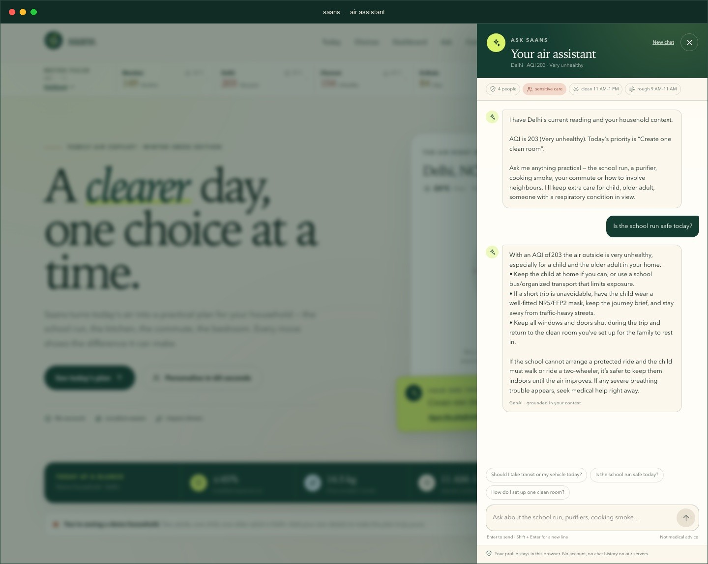
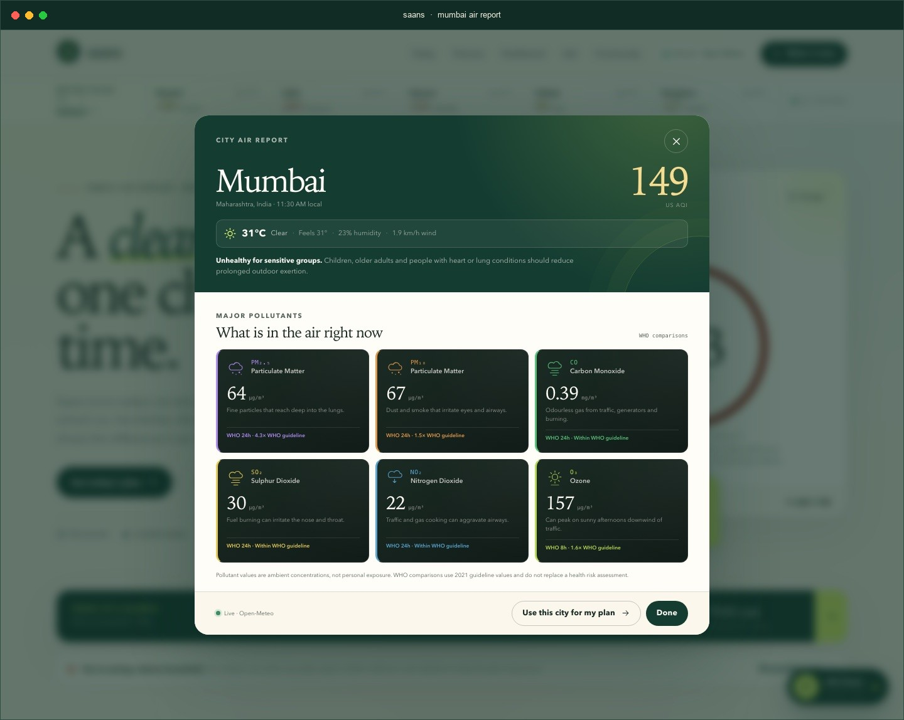

# Saans

**A family air copilot for severe winter smog and urban air pollution.**

[Repository](https://github.com/amardeepio/Saans) · [CI](https://github.com/amardeepio/Saans/actions/workflows/ci.yml)

Saans (Hindi for “breath”) turns a city’s live air quality into a practical, low-emission plan for a real household. It combines location, household vulnerability, home energy use, daily mobility and budget to answer three questions:

1. **What should we do today?**
2. **What will actually make a difference?**
3. **How do we keep the good habits going?**

The experience is a location-aware dashboard and a grounded AI chat assistant that opens from a floating button on the right. There is no login, no database and no server-side profile storage.

> Saans is not a medical device. It provides exposure-reduction guidance and modelled estimates, not diagnosis, treatment or guaranteed health outcomes.


<table>
  <tr>
    <td width="67%"></td>
    <td width="33%"></td>
  </tr>
  <tr>
    <td><sub>The context-aware chat drawer. The optional GenAI layer is grounded in the household plan and falls back safely.</sub></td>
    <td><sub>Responsive down to 390 px.</sub></td>
  </tr>
</table>

<table>
  <tr>
    <td width="58%"></td>
    <td width="42%"></td>
  </tr>
  <tr>
    <td><sub>Top polluted tracked cities, India-only search and a live pollutant watch.</sub></td>
    <td><sub>Click any metro card for a complete city air report.</sub></td>
  </tr>
</table>

---

## Chosen vertical

**Climate & sustainable living → urban air quality and household resilience.**

The primary persona is a multi-generational household in the Indo-Gangetic plain during winter smog: children, older adults, someone with a respiratory condition, a two-wheeler or car commute, and a real budget. A secondary persona is the neighbourhood organiser who needs a simple way to turn household habits into shared rules.

---

## What the app does

- **Live location context** — city search, browser geolocation, live air quality and current weather in Celsius from the free Open-Meteo API.
- **Metro pulse** — a compact strip directly below the header with AQI and temperature for Mumbai, Delhi, Chennai, Kolkata and Bengaluru.
- **Clickable city reports** — open any metro card for AQI, weather in °C and six major pollutants: PM2.5, PM10, CO, SO2, NO2 and O3.
- **India dashboard** — `/dashboard` ranks 24 major tracked Indian cities by AQI, provides India-only location search and shows a selected city’s pollutant mix.
- **Pollutant cards** — dark, colour-coded readings with WHO guideline comparisons and plain-language context.
- **Household-aware risk** — children, older adults, pregnancy, respiratory conditions and pets change the plan’s weight, not just the colour of a badge.
- **A daily playbook** — 6–9 time-ordered actions across the school run, commute, kitchen, cleaning, outdoor window, sleep and community.
- **Direct impact for every choice** — estimated PM2.5 exposure reduction, CO₂e avoided per month, rupee savings/cost and effort level.
- **A choices lab** — toggle realistic swaps (one transit day, no indoor burning, filtering one room, pressure cooking) and see the modelled difference update live.
- **A grounded assistant** — a right-side chat drawer with household context, suggested questions and an optional Groq/GenAI backend. If the provider is missing or unsafe, it falls back to a deterministic local assistant.
- **A community kit** — a ready-to-send neighbour note, no-idling/no-burning prompts and a clean-air corner idea.
- **A real fallback** — if live data fails, the UI clearly says it is using a sample winter pattern. Nothing pretends to be live.

---

## Approach and logic

### 1. Context before content

Saans collects only what changes the advice:

| Context | Why it matters |
| --- | --- |
| City / coordinates | Outdoor AQI, weather in °C and the cleanest two-hour window |
| Adults, children, older adults | Vulnerability weighting |
| Respiratory condition, pregnancy | Higher protection threshold |
| Cooking fuel, indoor smoke, purifier | Controllable indoor sources |
| Primary mobility, commute minutes, school run | Exposure and carbon trade-offs |
| Budget and priorities | Feasibility and what gets ranked first |

Profiles are saved only in `localStorage`, are versioned, and are re-validated when loaded.

### 2. A deterministic decision engine

`lib/engine.ts` builds a candidate set of actions, then scores and prunes it. The score combines:

- **Exposure benefit** — largest weight.
- **Household vulnerability** — children, older adults, respiratory conditions, pregnancy.
- **Carbon benefit** — for commutes and cooking.
- **Money** — savings or recurring cost.
- **Feasibility** — budget, purifier ownership, mobility mode, indoor smoke source.
- **Time and effort** — actions are re-ordered into a morning → midday → evening → night routine.

The engine uses explicit thresholds rather than a black box:

- AQI ≤ 50: clear
- 51–100: moderate
- 101–150: unhealthy for sensitive groups
- 151–200: unhealthy
- 201–300: very unhealthy
- 301+: hazardous

Risk is raised further for vulnerable households. The UI always shows the category, source and observation time.

### 3. Impact estimates are deliberately capped

Exposure values are **directional estimates**, not measurements:

- Each action gets an estimated share of daily PM2.5 exposure reduced.
- The household total combines these with diminishing returns, then caps the result at **45%**.
- Carbon estimates use typical Indian fuel/electricity assumptions.
- Cost estimates are monthly and can be positive (savings) or negative (spend).
- Every relevant panel has a “How these estimates work” disclosure.

This avoids the common trap of adding ten optimistic percentages together and presenting the result as a health promise.

### 4. Hybrid GenAI, with a safety net

The assistant has two layers:

**Layer 1 — optional GenAI**
- Any OpenAI-compatible endpoint can be used. The included configuration targets **Groq** with `openai/gpt-oss-120b`.
- The key lives only in `.env.local` / server environment variables. It is never sent to the browser.
- The system prompt includes household context and explicit safety rules.
- The response is converted to plain text and checked by a narrow output guard. Advice to open windows during dirty air, put a child on a two-wheeler in heavy smog, or use ozone/DIY purifier solutions is rejected.
- If the provider is slow, down, rate-limited or emits unsafe advice, Saans silently falls back.

**Layer 2 — deterministic local assistant**
- Intent detection maps the question to school, purifier, commute, outdoor timing, cooking smoke, health, cost, community, plants or sleep.
- Answers use the same live reading and household profile as the plan.
- The app remains fully usable without any API key.

### 5. Privacy and safety by default

- No account, cookies, analytics or database.
- Profile is stored in the browser.
- Chat history lives in component state and is not persisted.
- GenAI requests contain only the context needed for the answer; they are not logged by the app.
- The server does not expose secrets or provider error details.
- Medical red flags redirect to emergency care rather than attempting triage.

---

## How the solution works

```text
Browser
  ├─ 3-step household setup (local state + localStorage)
  ├─ daily playbook / choices lab / community kit / pollutant reports
  ├─ /dashboard: India ranking + India-only search
  ├─ chat drawer (floating button)
  └─ POST /api/chat
        ├─ same-origin check + in-memory rate limit + 24 KB body cap
        ├─ validate + clamp profile and air data
        ├─ build deterministic advice
        ├─ optional Groq request (server-only key, time-limited)
        │     └─ output guard → local fallback if unsafe/failed
        └─ JSON answer (no storage)

Server routes
  ├─ GET /api/air?lat&lon…     → Open-Meteo current + 24h forecast + weather
  │                              → labelled sample fallback on failure
  ├─ GET /api/cities           → five metro summaries (AQI, °C, pollutants)
  ├─ GET /api/india-cities     → 24-city India ranking (batched, cached 15 min)
  └─ GET /api/geocode?q=…      → curated cities + Open-Meteo geocoding
                                 (`country=IN` filters server-side)
```

### Project structure

```text
app/
  api/air/route.ts           Live air reading + sample fallback
  api/cities/route.ts        Five-metro AQI, weather and pollutant summaries
  api/india-cities/route.ts  24-city India ranking (one batched upstream call)
  api/chat/route.ts          Validated, rate-limited assistant endpoint
  api/geocode/route.ts       City search, optional India-only filter
  dashboard/page.tsx         India city dashboard
  globals.css                Design system and responsive layout
  layout.tsx                 Metadata, viewport, accessibility foundations
  page.tsx                   Server entry
  icon.svg                   App icon
components/
  SaansApp.tsx               Client dashboard composition
  AqiOrb.tsx                 AQI visual with source + category
  CityPulse.tsx              Five-metro AQI and °C strip below the header
  CityDetailDialog.tsx       Accessible city AQI + weather + pollutant report
  DashboardApp.tsx           India ranking + India-only search
  PollutantGrid.tsx          Six-card pollutant watch
  WeatherGlyph.tsx           WMO weather-code icons
  Playbook.tsx               Timeline, risk, windows and impact ledger
  ChoiceLab.tsx              Interactive swap simulator
  Assistant.tsx              Floating button + right-side chat drawer
  SetupDialog.tsx            Accessible 3-step profile dialog
  SwapsSection.tsx           Sustainable swaps + community note
lib/
  aqi.ts                     US EPA AQI, categories and risk weighting
  air.ts                     Open-Meteo fetch, parsing and fallback
  engine.ts                  Household decision engine
  assistant.ts               Intent-aware local assistant
  ai.ts                      Optional GenAI + output safety guard
  sample-air.ts              Deterministic, clearly-labelled sample data
  weather.ts                 Celsius weather labels and sample fallback
  pollutants.ts              Pollutant metadata, units and WHO comparisons
  india.ts                   India-only filtering and tracked-city universe
  validation.ts              Input clamping and local-storage schema
  rate-limit.ts              Small in-memory limiter
tests/                       51 unit tests (engine, AI guard, pollutants…)
```

---

## Run locally

Requires **Node.js 22+**.

```bash
git clone https://github.com/amardeepio/Saans.git
cd Saans
npm ci
npm run dev
```

Open [http://localhost:3000](http://localhost:3000).

### Optional GenAI

Create `.env.local`:

```bash
GROQ_API_KEY=your_key_here
AI_BASE_URL=https://api.groq.com/openai/v1
AI_MODEL=openai/gpt-oss-120b
```

`AI_API_KEY` is also supported for other OpenAI-compatible providers. Without these values the app still works completely using the local assistant.

### Commands

```bash
npm run dev        # Development server
npm run build      # Production build
npm run start      # Serve production build
npm run typecheck  # Strict TypeScript
npm test           # Vitest unit suite
npm run check      # typecheck + tests + build
```

---

## Testing and accessibility

### Tests

The suite covers:

- EPA PM2.5/AQI breakpoints and inverse mapping
- Risk escalation for sensitive households
- Advice generation across household types, fuels, commute modes and AQI bands
- Weather code labels and deterministic Celsius sample data
- Batched air + weather parsing for multi-city views
- Pollutant units, CO conversion and WHO comparison text
- India-only geocoding filters and tracked-city integrity
- The 45% household exposure cap
- Local assistant intent routing, medical red flags and script-injection attempts
- GenAI markdown cleanup, unsafe-output rejection and offline fallback
- Profile/air input clamping, versioned storage and malformed data
- Rate-limit windows and proxy key derivation

**51 tests across 10 files.** Run:

```bash
npm test
```

### Accessibility

- Semantic landmarks, headings and a skip link.
- Native `<dialog>` for the chat drawer and setup flow (focus trapping and Escape handling included).
- Keyboard-operable controls, visible focus rings and 44 px+ touch targets.
- `aria-live` updates for chat, form status and dynamic results.
- Status never relies on colour alone; AQI values and labels are textual.
- Reduced-motion support.
- Tested with axe-core at WCAG 2.1 A/AA across the home page, chat drawer, all three setup steps and mobile: **0 violations** at the time of writing.
- Responsive from 390 px through large desktop.

---

## Security notes

- Strict TypeScript, input validation and clamped numeric ranges.
- Security headers: CSP, HSTS, `X-Content-Type-Options`, `X-Frame-Options`, COOP, CORP, referrer policy and a tight permissions policy.
- Server-only AI credentials; no `NEXT_PUBLIC_` secrets.
- Same-origin check on the chat POST route; request size cap; in-memory rate limiting.
- Prompt-injection framing: household context is labelled untrusted data, not instructions.
- AI output safety guard plus deterministic fallback.
- No HTML rendering of model output; React escapes all content and markdown is flattened to text.
- No user data stored server-side.
- `npm audit` reports 0 known vulnerabilities at build time.

### Deployment notes

- Set `GROQ_API_KEY` (or `AI_API_KEY`) as a server environment variable in your host.
- In a multi-instance deployment, replace the in-memory limiter with a shared store (for example Redis or the platform’s rate-limit service).
- Open-Meteo needs no API key. Respect its attribution and usage guidance.

---

## Assumptions

- The primary context is the Indo-Gangetic plain in winter, but any city works.
- `commute minutes` means one-way time; carbon estimates assume ~20 working days a month and typical average speeds.
- Cost figures are indicative Indian rupee estimates, not quotes.
- “Cleanest window” is selected from the next 24 hourly points and is not a guarantee of health safety.
- Household vulnerability raises caution; it does not create a diagnosis.
- Local storage is assumed acceptable for a no-account, privacy-first demo. A future version could add encrypted, user-owned sync.

## Limitations

- Exposure and carbon values are simplified models, not sensor readings or a formal health risk assessment.
- Open-Meteo air and weather forecasts can lag real-time conditions; the UI labels observation time and sample fallback. All temperatures are shown in Celsius.
- The local assistant is intentionally bounded. The GenAI layer handles broader phrasing when configured.
- The in-memory limiter resets on redeploy and is per instance.

---

## Data and attribution

- Air quality and geocoding: [Open-Meteo](https://open-meteo.com/) (free, no key required).
- AQI scale: US EPA PM2.5 breakpoints.
- Icons: hand-drawn inline SVG.
- Typography: system serif and sans stacks; no remote font requests.

## License

MIT. See [LICENSE](LICENSE).
